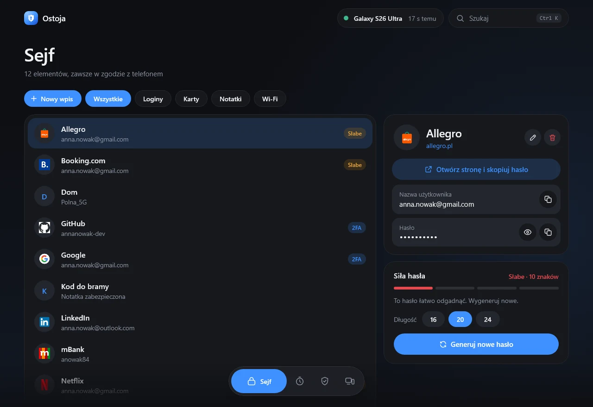
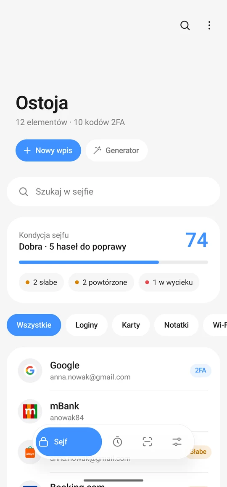
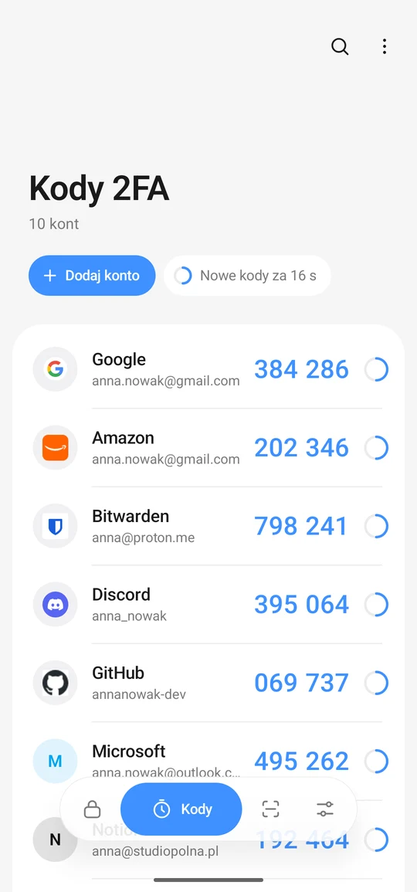
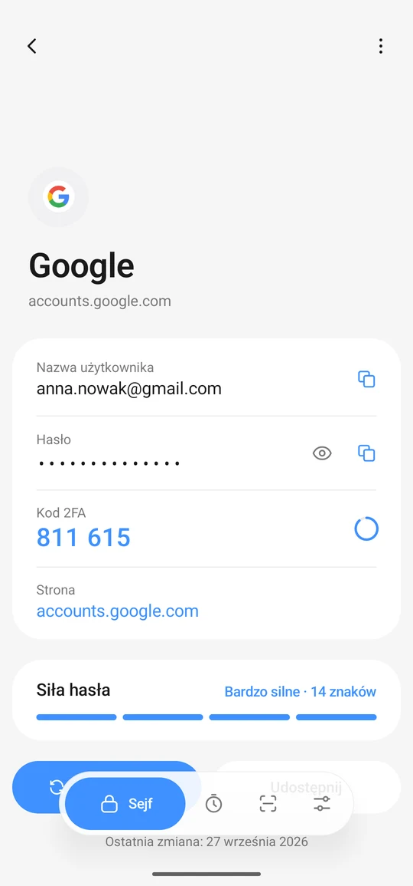
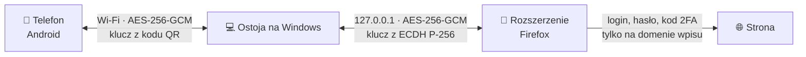

<div align="center">

<picture>
  <source media="(prefers-color-scheme: dark)" srcset="design/logo-dark.png">
  
</picture>

**Hasła i kody 2FA na telefonie i komputerze. Bez konta i bez chmury.**

[](https://github.com/xwolter/ostoja/releases/latest)
[](LICENSE)
[](https://github.com/xwolter/ostoja/actions/workflows/release.yml)


[**Strona projektu**](https://xwolter.github.io/ostoja/) · [**Pobierz**](#pobieranie) · [Jak to działa](#jak-to-działa) · [Bezpieczeństwo](#bezpieczeństwo) · [Dokumentacja techniczna](docs/TECHNICZNE.md)

<br>



</div>

<br>

## Czym jest Ostoja

Ostoja to menedżer haseł i aplikacja do kodów 2FA w jednym. Działa na **Androidzie** i **Windows**, a rozszerzenie do **Firefoksa** loguje się na stronach za Ciebie: otwiera stronę, wpisuje login, hasło i kod 2FA.

Telefon i komputer synchronizują się bezpośrednio w domowej sieci Wi‑Fi. Nie ma konta, serwera ani chmury, przez które przechodziłyby Twoje dane.

<table>
  <tr>
    <td width="33%"></td>
    <td width="33%"></td>
    <td width="33%"></td>
  </tr>
  <tr>
    <td align="center"><b>Sejf</b><br><sub>loginy, karty, notatki, Wi‑Fi</sub></td>
    <td align="center"><b>Kody 2FA</b><br><sub>TOTP i HOTP z odliczaniem</sub></td>
    <td align="center"><b>Wpis</b><br><sub>hasło, kod i siła hasła w jednym miejscu</sub></td>
  </tr>
</table>

## Funkcje

| | Telefon | Komputer | Firefox |
|---|:---:|:---:|:---:|
| Sejf haseł, kart, notatek i Wi‑Fi | ✅ | ✅ | |
| Kody 2FA (TOTP/HOTP, SHA‑1/256/512, 6-8 cyfr) | ✅ | ✅ | ✅ wpisuje sam |
| Skanowanie kodów QR | aparat, galeria | ekran, schowek | z otwartej strony |
| Logowanie jednym kliknięciem | „Zaloguj na komputerze” | „Otwórz i zaloguj” | otwiera stronę i loguje |
| Autouzupełnianie | aplikacje i przeglądarki | | formularze logowania |
| Zapisywanie nowych haseł | ✅ | ✅ | pyta po zalogowaniu |
| Kondycja sejfu (słabe, powtórzone, wycieki) | ✅ | ✅ | |
| Widżety i kod na ekranie blokady | ✅ | | |
| Potwierdzanie logowania na komputerze | odcisk palca | | |

Do tego: przenoszenie kodów 2FA z Google Authenticatora (eksport z kilku kodów QR, aparatem albo ze zdjęć) i przewodnik po przepinaniu kont z Microsoft Authenticatora, generator haseł, import z Chrome, Samsung Pass, Bitwardena i Microsoft Authenticatora, eksport zaszyfrowanej kopii, jasny i ciemny motyw z czterema kolorami akcentu.

## Pobieranie

| Plik | Dla | |
|---|---|---|
| [`Ostoja-Windows.msi`](https://github.com/xwolter/ostoja/releases/latest/download/Ostoja-Windows.msi) | Windows 10/11, 64‑bit | instalator; aktualizuje poprzednią wersję z zachowaniem danych |
| [`Ostoja.apk`](https://github.com/xwolter/ostoja/releases/latest/download/Ostoja.apk) | Android 9+ | wymaga zgody na instalację z pliku |
| `Ostoja-Firefox.xpi` | Firefox 140+ | rozszerzenie podpisane przez Mozillę, w [wydaniach](https://github.com/xwolter/ostoja/releases) |

### Szybki start

1. **Komputer:** zainstaluj `Ostoja-Windows.msi`. Przy pierwszym uruchomieniu pozwól na dostęp w sieciach prywatnych.
2. **Telefon:** zainstaluj `Ostoja.apk`, wejdź w *Ustawienia → Połącz z komputerem* i zeskanuj kod QR z okna Ostoi.
3. **Firefox:** zainstaluj rozszerzenie i połącz je z aplikacją - oba okna pokażą ten sam 6‑cyfrowy kod.

## Jak to działa



- **Telefon ↔ komputer:** kod QR niesie losowy 32‑bajtowy sekret, z którego oba urządzenia wyprowadzają klucz (HKDF‑SHA256). Każde zapytanie jest szyfrowane i uwierzytelniane, ma znacznik czasu i numer jednorazowy.
- **Każde urządzenie ma pełny sejf.** Przy spotkaniu stany są scalane wpis po wpisie; nowsza zmiana wygrywa, a usunięcia przechodzą jako „nagrobki”.
- **Komputer co 7 dni blokuje sejf.** Odblokowujesz go na telefonie: wybierasz liczbę z ekranu komputera i przykładasz palec.
- **Rozszerzenie nie przechowuje haseł.** Dostaje je z aplikacji na jedno logowanie i wpisuje tylko na domenie wpisu.

Więcej: [dokumentacja techniczna](docs/TECHNICZNE.md).

## Bezpieczeństwo

- 🔐 Sejf na telefonie szyfrowany kluczem z Android Keystore, na komputerze kluczem chronionym przez Windows DPAPI.
- 🌐 Granica domeny uwzględnia sufiksy publiczne - hasło do `twojprojekt.github.io` nie trafi na `obcy.github.io`.
- 🔒 Rozszerzenie nie wpisze hasła na stronie `http://`, gdy wpis jest dla `https://`, ani na innej domenie po przekierowaniu.
- 📱 Autouzupełnianie wierzy adresowi strony tylko w przeglądarkach; zwykła aplikacja zawsze dostaje pytanie z nazwą pakietu.
- 📋 Skopiowane hasła znikają ze schowka po 30 s i nie trafiają do historii schowka Windows ani do chmury.
- 🕵️ Sprawdzanie wycieków przez Have I Been Pwned wysyła tylko 5 znaków skrótu SHA‑1 (k‑anonimowość).

Znalazłeś lukę? Napisz na [wolter.biznes@gmail.com](mailto:wolter.biznes@gmail.com) zamiast zakładać publiczne zgłoszenie.

## Budowanie

Potrzebne: JDK 17+ i Android SDK (ścieżka w `local.properties`: `sdk.dir=...`).

```bash
./gradlew :shared:test :desktop:test          # testy
./gradlew :desktop:packageMsi                 # instalator Windows
./gradlew :app:assembleRelease                # APK
cd web && npm install && npm run build        # strona projektu (statyczny eksport w web/out)
```

Znacznik `v*` (np. `v1.2.8`) uruchamia [GitHub Actions](.github/workflows/release.yml), które budują instalator i APK i dołączają je do wydania.

## Struktura

| Folder | Co zawiera |
|---|---|
| [`shared/`](shared) | wspólny kod w Kotlinie: sejf, TOTP/HOTP, siła haseł, scalanie, protokół synchronizacji, domeny, odczyt QR (z testami) |
| [`app/`](app) | aplikacja na Androida (Jetpack Compose, styl One UI) |
| [`desktop/`](desktop) | aplikacja na Windows (Compose Desktop): okno, ikona przy zegarze, serwer synchronizacji |
| [`firefox/`](firefox) | rozszerzenie: logowanie, kody 2FA, zapisywanie haseł |
| [`web/`](web) | [strona projektu](https://xwolter.github.io/ostoja/) (Next.js) |
| [`docs/`](docs) | dokumentacja techniczna |

## Licencja

[MIT](LICENSE) © 2026 [xwolter](https://github.com/xwolter)
